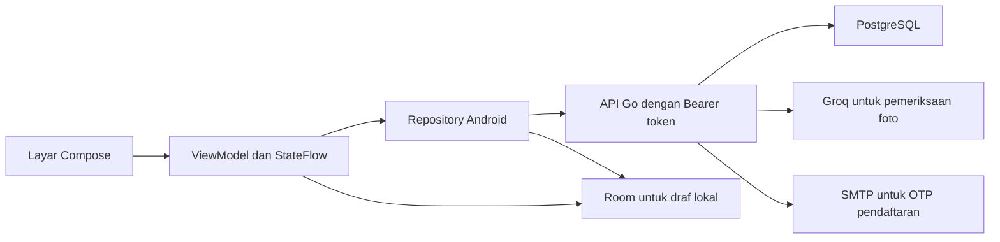
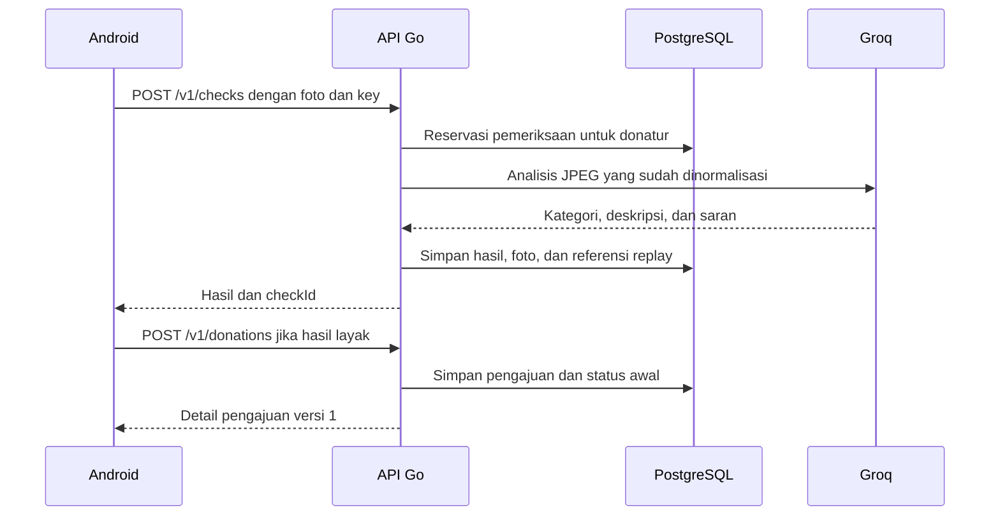

# Arsitektur Loopy

Aplikasi Android mengelola interaksi dan state tampilan. API Go mengautentikasi akun, memeriksa pakaian, menjalankan transaksi, dan menjadi sumber data bersama untuk donatur serta admin. PostgreSQL menyimpan akun, sesi, foto privat, pengajuan, riwayat, dan saldo. [Model data](data-model.md) · [Kontrak API](api-contract.md)

## Android dari aplikasi dibuka sampai request selesai

| Lapisan | Titik masuk | Cara kerja |
| --- | --- | --- |
| Startup | [MainActivity dan LoopyApplication](../android/app/src/main/java/id/ac/loopy/README.md) | Activity memasang tema dan `LoopyApp`. Application menyediakan satu `AppContainer` untuk proses aplikasi. |
| Navigasi | [LoopyApp.kt](../android/app/src/main/java/id/ac/loopy/ui/LoopyApp.kt) | S01 adalah tujuan awal. Setelah masuk, donatur diarahkan ke S04 dan admin ke A01. Rute terjaga memeriksa sesi dan role. |
| State | [Folder fitur](../android/app/src/main/java/id/ac/loopy/feature/README.md) | ViewModel menerima aksi, menjalankan coroutine, lalu menerbitkan state loading, data, atau error. Compose membaca `StateFlow` dengan lifecycle. |
| Data | [Repository Android](../android/app/src/main/java/id/ac/loopy/data/repository/README.md) | Repository mengirim request Retrofit dengan Bearer token, menerjemahkan DTO, dan menangani percobaan ulang bila alur mendukung. |
| Perakitan | [AppContainer.kt](../android/app/src/main/java/id/ac/loopy/di/AppContainer.kt) | Room, OkHttp, Retrofit, DAO, dan repository disusun bersama. Retrofit membaca URL dari `BuildConfig.API_BASE_URL` saat proses dibuat. |

Panah kembali mem-pop entri navigasi. Pergantian tab donatur menggunakan Beranda sebagai dasar stack. Saat kembali ke Beranda, entri tersebut dipakai langsung agar state tab sebelumnya tidak terbuka lagi. Avatar membuka profil sesuai role. Aksi keluar di profil dikaitkan dengan lifecycle `RESUMED` supaya tap setelah meninggalkan profil tidak mengakhiri sesi. [Peta layar](screen-map.md) · [Tes navigasi](../android/app/src/androidTest/java/id/ac/loopy/feature/README.md)

## Backend dari HTTP sampai transaksi

1. [main.go](../backend/go/main.go) membaca konfigurasi, menyiapkan pool PostgreSQL, menjalankan migrasi, lalu memasang handler.
2. [server.go](../backend/go/internal/httpapi/server.go) memilih rute, menerapkan batas request dan timeout, lalu memeriksa Bearer token dan role pada endpoint yang dilindungi.
3. Handler menormalisasi input sesuai kontrak [domain Go](../backend/go/internal/domain/README.md), lalu menjalankan service atau metode repository.
4. [Store PostgreSQL](../backend/go/internal/store/README.md) menyimpan perubahan atomik. Contohnya, pengajuan baru dan riwayat versi pertamanya tersimpan bersama. Penyelesaian donasi juga menyimpan status, riwayat, kredit, dan saldo dalam transaksi yang sama.
5. Android memetakan respons ke state. API mengembalikan kode error untuk kasus seperti sesi habis, field tidak valid, versi pengajuan berubah, atau provider belum tersedia.

Guard Android mengarahkan tampilan. Server memeriksa identitas, role, dan kepemilikan pada setiap request yang memerlukannya. Rute foto dan detail membawa ID, sehingga data kontak, foto, dan alamat dibaca melalui API berautentikasi.

## Contoh alur pemeriksaan sampai pengajuan

S05 membuka Photo Picker atau kamera dengan URI `FileProvider`. S06 mengambil metadata dan foto menggunakan `checkId`. S07 menambahkan kontak, jumlah, dan preferensi jadwal. Backend memvalidasi pemilik dan hasil layak sebelum menulis `PENDING_REVIEW`. Untuk percobaan ulang setelah gangguan jaringan, repository upload dan pickup mempertahankan key selama instance proses masih hidup. [Pemeriksaan](backend.md#pemeriksaan-pakaian-go) · [Pickup dan keputusan admin](donation-review-go.md)

## Data yang hidup di perangkat

| Data | Lokasi | Masa berlaku |
| --- | --- | --- |
| Sesi dan challenge OTP | Repository atau ViewModel dalam memori | Mengikuti proses aplikasi. Restart proses memerlukan login ulang atau memulai kembali pendaftaran. |
| Draf jadwal admin | Room versi 2 | Tersimpan menurut ID admin dan pengajuan. Jadwal final disimpan di API setelah dikonfirmasi. |
| Preferensi tema | DataStore | Dibaca saat Activity dibuat dan tersedia kembali ketika aplikasi dibuka. |
| Foto dari kamera | Cache privat melalui `FileProvider` | Dipakai untuk mengambil gambar dan mengirimnya ke API. Foto pemeriksaan yang sudah tersimpan dibaca kembali melalui endpoint privat. |
| Saldo, status, dan reward | PostgreSQL | Aplikasi memperoleh nilai terbaru melalui request API. |

Varian debug dan release sama-sama memakai graf yang dimulai dari landing. Debug mengizinkan HTTP development. Release membaca URL HTTPS dan memerlukan penandatanganan untuk distribusi. Kunci Groq, SMTP, dan OTP berada di server. [Development](development.md) · [Deploy](deploy-lxc.md)

## Mengubah fitur lintas lapisan

Mulai dari rute dan state layar, lalu telusuri repository, DTO, dan handler untuk menentukan apakah API perlu berubah. Perubahan schema memakai migrasi bernomor baru. Perbarui contoh payload, kondisi error, dan skenario penerimaan bersama perubahannya. Jalankan unit test Android, tes API dengan PostgreSQL, dan tes perangkat untuk perilaku Compose yang terpengaruh. [Hasil verifikasi](verification.md)

Resource diedit di `android/app/src/main/res`. `prepareMainResources` menyalin resource dan mengecualikan Markdown dari input kompilasi. Versi Compose, Room dan DataStore dipin melalui katalog Gradle. [Katalog versi](../android/gradle/libs.versions.toml) · [Resource Android](../android/app/src/main/res/README.md)
