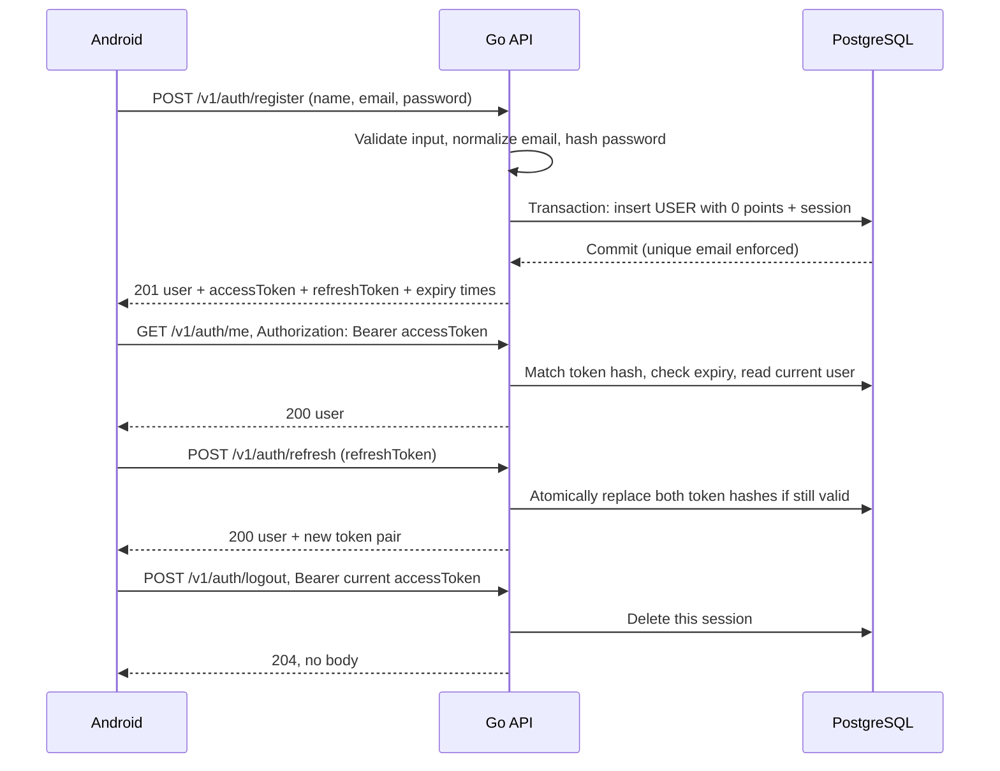

# Loopy authentication in Go: flow, code, and theory

This guide implements PRD v2.1 **F02**, the account fields in [data-model.md](data-model.md), and the auth endpoints in [api-contract.md](api-contract.md). Read the flow first, then the code map and theory. The runnable source lives in [`backend/go/`](../backend/go/README.md). Docker runs the same Go service for authentication, clothing checks, and pickup review.

## 1. Authentication flow



### Register

1. Accept only `name`, `email`, and `password`. Reject unknown fields, including `role`, `userId`, and `totalPoints`.
2. Trim name and email, lowercase the entire email as a deliberate Loopy account policy. Never trim or lowercase the password.
3. Validate name (1–100 Unicode characters, no control characters), email (plain address, at most 254 bytes), and password (8–128 Unicode characters, at most 512 bytes). This password policy is an implementation decision; the PRD does not specify a length.
4. Generate a UUID and an Argon2id password hash with a fresh random salt.
5. Generate an access token and a separate refresh token, each with 32 random bytes. Persist their SHA-256 hashes only.
6. Insert the user (`USER`, 0 points) and session in one transaction. A unique database constraint handles duplicate emails, including simultaneous requests. If session creation fails, the user insert rolls back.
7. Return HTTP 201 with the user and token pair. Android can go directly to Home because registration creates a session.

### Login and role routing

1. Accept email/password, normalize email, load the account, and verify its stored password hash. Missing accounts perform a dummy password verification to reduce timing differences.
2. Unknown email and incorrect password both return the same `401 INVALID_CREDENTIALS` response.
3. Create a new independent session. Login on a second device does not terminate the first device.
4. Return HTTP 200 with tokens and the current user. Android routes `USER` to Home and `ADMIN` to Admin Dashboard. Navigation is a UI choice; server middleware must still enforce admin authorization.
5. Public registration always creates `USER`. Provision an admin with the private CLI described below; there is no public admin registration endpoint.

### Protected requests, refresh, and logout

- Send `Authorization: Bearer <accessToken>` on protected requests. The server hashes the token and loads its unexpired session and current user from PostgreSQL. `/me` returns the current role and points from the database.
- Access tokens last **15 minutes**. Refresh tokens last **30 days from login/register**, with an absolute expiry that does not slide forward.
- On access expiry, call `POST /v1/auth/refresh` with the refresh token. Rotation replaces both token hashes in one conditional database update. The old access and refresh tokens stop working immediately; simultaneous refreshes have only one winner.
- Android must serialize refresh attempts and atomically replace the saved token pair. If a refresh response is lost, the old refresh token cannot recover it; require login again. Reuse returns 401; it does not revoke the winning session or implement token-family theft detection.
- Logout requires a valid current access token and deletes that session, invalidating both tokens immediately. If access expired, refresh first; if refresh also fails, clear local state. Other device sessions remain active.
- After logout, clear tokens and all cached account data. Keep token material protected by Android Keystore-backed storage. Never persist the user's password.

## 2. Exact HTTP contract

All bodies use `Content-Type: application/json`. Auth responses send `Cache-Control: no-store`. Date strings are UTC RFC 3339. Tokens below are placeholders.

| Method and path | Request | Success | Access |
| --- | --- | --- | --- |
| `POST /v1/auth/register` | `{"name":"Neva","email":"neva@example.test","password":"a long sample passphrase"}` | 201 session response | Public |
| `POST /v1/auth/login` | `{"email":"neva@example.test","password":"a long sample passphrase"}` | 200 session response | Public |
| `POST /v1/auth/refresh` | `{"refreshToken":"<refresh>"}` | 200 replacement session response | Refresh token |
| `GET /v1/auth/me` | No body | 200 user object | Access token |
| `POST /v1/auth/logout` | No body | 204, no body | Access token |
| `GET /health` | No body | 200 `{"status":"ok","mode":"go-auth"}` | Public liveness |
| `GET /ready` | No body | 200 if DB reachable; otherwise 503 | Public readiness |

Session response for register, login, and refresh:

```json
{
  "accessToken": "<opaque access token>",
  "refreshToken": "<opaque refresh token>",
  "tokenType": "Bearer",
  "expiresAt": "2026-11-17T10:15:00Z",
  "refreshExpiresAt": "2026-12-17T10:00:00Z",
  "user": {
    "userId": "<server-generated UUID>",
    "name": "Neva",
    "email": "neva@example.test",
    "role": "USER",
    "totalPoints": 0
  }
}
```

`GET /v1/auth/me` returns the `user` object directly. An example validation failure:

```json
{"error":{"code":"VALIDATION_ERROR","message":"Check the submitted fields.","fieldErrors":{"password":"Use 8–128 characters (at most 512 bytes)."}}}
```

Errors: 400 malformed JSON/unknown fields; 401 invalid credentials/session; 403 authenticated but wrong role; 409 duplicate email; 413 body over 16 KiB; 415 non-JSON body; 422 field validation; 429 auth rate limit; 500 unexpected server failure; 503 readiness failure. Do not expose SQL, stack traces, password hashes, or tokens in errors/logs.

## 3. Code needed and where to read it

| File in `backend/go/` | Responsibility | Why it exists |
| --- | --- | --- |
| `main.go` | Environment, DB connection, migration startup, private admin command, HTTP timeouts/shutdown | Composition root; secrets stay on server |
| `password.go` | Argon2id salted hashing and constant-time verification | Slow offline guessing after a DB leak |
| `store.go` | Parameterized PostgreSQL queries, atomic registration/rotation, migration | Persistence and concurrency guarantees |
| `schema.sql` | `users`, `auth_sessions`, constraints, indexes | Database enforces invariants |
| `auth.go` | Validation, random IDs/tokens, response models, register/login/refresh | Business rules independent of HTTP parsing |
| `http.go` | Routes, JSON errors, Bearer middleware, role guard, rate limiter | HTTP boundary and authorization |
| `auth_test.go` | Validation, hashing, HTTP/middleware tests | Fast checks without a database |
| `store_integration_test.go` | Real PostgreSQL flow, races, rollback, persistence | Evidence for behavior mocks cannot establish |

The important code patterns are:

```go
// Password hashing: fresh random salt + memory/cpu cost.
key := argon2.IDKey([]byte(password), salt, 2, 19*1024, 1, 32)

// Session tokens: random secrets, only the hashes go to PostgreSQL.
secret := make([]byte, 32)
_, err := rand.Read(secret) // handle err before using secret
token := base64.RawURLEncoding.EncodeToString(secret)
digest := sha256.Sum256([]byte(token))

// Public registration cannot assign privileges.
// role and points come from SQL defaults; request has no such fields.
// INSERT INTO users (user_id, name, email, password_hash) VALUES ($1,$2,$3,$4)

// Protect future admin handlers with BOTH middleware layers.
// mux.Handle("GET /v1/admin/summary",
//     api.authenticate(requireRole("ADMIN", summaryHandler)))
// For owner-only queries use the authenticated user's ID in WHERE user_id=$1.
```

These snippets explain the mechanisms; follow the linked source for complete error handling, transactions, and tests. The Android client uses Retrofit for registration, login, and serialized refresh in memory.

### Walkthrough: from JSON to a committed account

The request moves through `net/http handler -> auth service -> PostgreSQL repository`. Each layer has one job: the handler speaks HTTP, the service applies account rules, and the repository executes SQL. Go structs describe the data, `json` tags define Android's field names, `context.Context` carries cancellation/deadlines, and explicit `error` returns let the caller handle failures.

The register handler in [`http.go`](../backend/go/http.go) parses the JSON object, rejects unknown fields, calls the service, and maps success to HTTP 201:

```go
func (a *api) register(w http.ResponseWriter, r *http.Request) {
    var req registerRequest
    if err := decodeJSON(w, r, &req); err != nil {
        writeError(w, err)
        return
    }
    response, err := a.auth.register(r.Context(), req)
    if err != nil {
        writeError(w, err)
        return
    }
    writeJSON(w, 201, response)
}
```

The service in [`auth.go`](../backend/go/auth.go) validates first, then builds a hashed account and random session. It passes both to one repository operation:

```go
func (a *authService) register(ctx context.Context, req registerRequest) (sessionResponse, error) {
    req, err := validateRegistration(req)
    if err != nil { return sessionResponse{}, err }
    u, err := makeAccount(req)
    if err != nil { return sessionResponse{}, err }
    s, response, err := newSession(u.ID)
    if err != nil { return sessionResponse{}, err }
    response.User, err = a.store.Register(ctx, u, s)
    return response, accountError(err)
}
```

[`store.go`](../backend/go/store.go) opens a transaction, inserts the user, inserts the session, and commits. A deferred rollback covers every failure before commit. The user INSERT deliberately omits role and points, so [`schema.sql`](../backend/go/schema.sql) supplies `USER` and `0`. SQL values use `$1`, `$2`, etc., with arguments passed separately. The returned `user` type contains no password hash.

### Walkthrough: checking a protected request

The route in [`http.go`](../backend/go/http.go) wraps its handler with `authenticate`:

```go
mux.Handle("GET /v1/auth/me", a.authenticate(http.HandlerFunc(func(w http.ResponseWriter, r *http.Request) {
    writeJSON(w, 200, currentPrincipal(r).User)
})))
```

The middleware validates the Bearer token format, computes its SHA-256 digest, and calls `store.Authenticate`. The database joins the session to its current account and rejects expired sessions. The middleware puts that trusted identity into the request context. The handler reads it through `currentPrincipal`; Android never chooses which user `/me` returns. Future admin handlers must also use `requireRole("ADMIN", handler)` inside `authenticate`.

### Walkthrough: refresh without a race

The core SQL in [`store.go`](../backend/go/store.go) consumes the old refresh digest and returns the account plus actual expiry times in one statement:

```sql
WITH rotated AS (
    UPDATE auth_sessions
    SET access_hash = $2,
        refresh_hash = $3,
        access_expires_at = LEAST($4, refresh_expires_at)
    WHERE refresh_hash = $1 AND refresh_expires_at > now()
    RETURNING user_id, access_expires_at, refresh_expires_at
)
SELECT u.user_id::text, u.name, u.email, u.role, u.total_points,
       r.access_expires_at, r.refresh_expires_at
FROM rotated r JOIN users u USING (user_id);
```

`$1` is the old token digest; `$2` and `$3` are new digests; `$4` is a new 15-minute access expiry. `LEAST` prevents access from outliving the absolute refresh expiry. No returned row means the token is invalid, expired, or already consumed. PostgreSQL rechecks the update condition after a concurrent writer finishes, so only one refresh succeeds.

## 4. Theory behind the design

**Authentication vs authorization.** Authentication proves which account owns a request. Authorization decides which action that account may take. A Bearer token authenticates a session; a server-loaded `ADMIN` role authorizes admin actions. Never trust role or owner IDs supplied by the app. Loading the current user on each request also makes role changes visible immediately.

**Password hashing vs encryption.** Password verification needs no reversible password. Argon2id combines the password with a unique salt and deliberately spends memory and CPU (here 19 MiB, two passes, one lane). The encoded record includes algorithm, version, parameters, salt, and digest. Verification parses that record with strict parameter limits and uses constant-time digest comparison. Random salts make identical passwords produce different records. These parameters follow the [OWASP password storage guidance](https://cheatsheetseries.owasp.org/cheatsheets/Password_Storage_Cheat_Sheet.html); load-test and tune them for deployment.

**Opaque tokens vs JWTs.** This design uses random opaque tokens, which contain no user data. JWTs carry signed claims and need careful signing-key, expiry, and revocation design. Loopy already needs server-side logout and a PostgreSQL database, so a session lookup is a straightforward choice. A token is a bearer credential: anyone who obtains it can use it, so HTTPS and protected client storage matter. See [OWASP session management](https://cheatsheetseries.owasp.org/cheatsheets/Session_Management_Cheat_Sheet.html).

**Why SHA-256 for tokens but Argon2id for passwords?** Passwords are human-chosen and guessable, so their hashes must be expensive. Each token has 256 bits of cryptographic randomness, making offline guessing impractical; a fast token hash enables indexed lookups without storing the credential itself. A database dump alone should not reveal usable tokens.

**Transactions and constraints.** Checking whether an email exists and then inserting is unsafe when two requests race. A `UNIQUE` constraint is authoritative. Registration wraps user + session creation in one transaction, so either both commit or neither does. Refresh uses an atomic compare-and-replace update: a consumed token cannot win twice. Queries use placeholders, with values passed separately, to prevent SQL injection. The [pgx documentation](https://pkg.go.dev/github.com/jackc/pgx/v5) describes the driver and transaction APIs.

**Rate limiting and bounded work.** Auth endpoints share a per-peer-IP limit (20 attempts/minute) before expensive hashing. The limiter also caps simultaneous password-hashing work at four requests. It uses the direct socket peer, ignoring untrusted forwarded headers. Multiple replicas need a shared gateway limiter; a reverse proxy needs an explicit trusted-proxy policy. Limits are development defaults and can block users who share an IP.

## 5. Run and provision accounts

From the repository root, `Copy-Item .env.example .env` (if absent), then `docker compose up --build -d --wait`. PostgreSQL data survives normal container restarts. Migrations run transactionally at startup under a PostgreSQL advisory lock. `/health` is liveness; `/ready` pings the DB.

For a host run, install Go 1.27.4+ and PostgreSQL 17, then in PowerShell (Go installations with automatic toolchain selection can download the version required by `go.mod`):

```powershell
cd backend/go
$env:DATABASE_URL = 'postgres://loopy:<url-encoded-password>@127.0.0.1:5432/loopy?sslmode=disable'
$env:HTTP_ADDR = '127.0.0.1:8080'
go run .
```

The host server reads environment variables, not `.env` files. Compose constructs its connection from `POSTGRES_*` variables, escaping the username/password correctly. PostgreSQL in Compose is reachable by the backend through `db:5432`; it is not published on the host. The host-run example assumes a separate local PostgreSQL instance. Use TLS for database connections outside local development.

Create an admin with the same password policy through a trusted terminal. Set `LOOPY_ADMIN_NAME`, `LOOPY_ADMIN_EMAIL`, and `LOOPY_ADMIN_PASSWORD` privately, then run `go run . create-admin` (host) or `docker compose run --rm -e LOOPY_ADMIN_NAME -e LOOPY_ADMIN_EMAIL -e LOOPY_ADMIN_PASSWORD backend create-admin`. The command creates a new admin, refuses existing emails, issues no session, and prints no password. Remove the password environment variable afterward. Never commit credentials or accept an admin role in the public request.

Android emulator base URL remains `http://10.0.2.2:8080/`. Use HTTPS for release. Browser cookies/CORS are not part of this native Android Bearer-token API.

### Try the flow from PowerShell

With the backend running, use disposable account data. `Invoke-RestMethod` parses each JSON response into a PowerShell object:

```powershell
$baseUrl = 'http://localhost:8080'
$body = @{ name = 'Neva'; email = 'neva@example.test'; password = 'a long sample passphrase' } | ConvertTo-Json
$session = Invoke-RestMethod -Method Post -Uri "$baseUrl/v1/auth/register" -ContentType 'application/json' -Body $body
$headers = @{ Authorization = "Bearer $($session.accessToken)" }
Invoke-RestMethod -Uri "$baseUrl/v1/auth/me" -Headers $headers

$refresh = @{ refreshToken = $session.refreshToken } | ConvertTo-Json
$session = Invoke-RestMethod -Method Post -Uri "$baseUrl/v1/auth/refresh" -ContentType 'application/json' -Body $refresh
$headers = @{ Authorization = "Bearer $($session.accessToken)" }
Invoke-RestMethod -Method Post -Uri "$baseUrl/v1/auth/logout" -Headers $headers

$login = @{ email = 'neva@example.test'; password = 'a long sample passphrase' } | ConvertTo-Json
$session = Invoke-RestMethod -Method Post -Uri "$baseUrl/v1/auth/login" -ContentType 'application/json' -Body $login
```

Android follows these same requests through Retrofit and an auth repository. Keep the token pair and account together in session state, attach only the access token to API requests, serialize refresh on 401, retry the original request once, and return to Login if refresh fails. Choose Home/Admin Dashboard from the returned role. The backend role guard remains necessary even when Android hides an admin screen.

## 6. Verification and limits

Run `go test ./...` and `go vet ./...` inside `backend/go`. Set `TEST_DATABASE_URL` to a disposable PostgreSQL database before `go test -count=1 ./...` to include integration tests; each run creates and drops its own uniquely named schema. CI supplies PostgreSQL. Integration tests must never point at production.

Run `go run golang.org/x/vuln/cmd/govulncheck@v1.9.0 ./...` to check known reachable Go vulnerabilities. Keep the minimum Go patch in `go.mod`, the Docker Go image, and dependency versions updated together; security fixes also arrive in the Go standard library. Go releases are published on the [official download page](https://go.dev/dl/). A passing scan covers known findings at the time it runs.

Verify register -> me -> refresh -> old tokens rejected -> logout -> both new tokens rejected; duplicate normalized emails; invalid password/malformed requests; injected role rejected; admin login/role guard; registration rollback; concurrent duplicate registration and refresh; token expiry; and sessions surviving new server instances.

This F02 implementation covers account registration and revocable sessions. Expired records are rejected even before cleanup. The [backend guide](backend.md) tracks the current state of email verification, Android integration, and the business endpoints. The full AC-03/04/19/20 need Android integration and owner-specific business endpoints before they can be marked complete.
