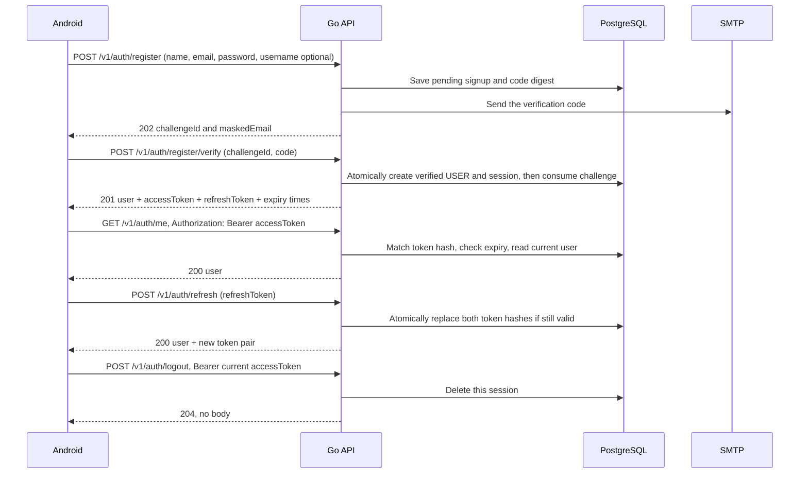

# Loopy authentication in Go: flow, code, and theory

This guide implements PRD v2.1 **F02**, the account fields in [data-model.md](data-model.md), and the auth endpoints in [api-contract.md](api-contract.md). Read the flow first, then the code map and theory. The runnable source lives in [`backend/go/`](../backend/go/README.md). Docker runs the same Go service for authentication, clothing checks, and pickup review.

## 1. Authentication flow



### Register

1. Accept `name`, `email`, `password`, and optional `username`. Normalize name, email, and username. Usernames use 3–20 ASCII letters, digits, or underscores and are stored in lowercase. Passwords use 8–128 Unicode characters and at most 512 bytes.
2. Store the Argon2id password hash and a digest of a random six-digit code in a pending registration. Send the code to the email address over SMTP and return HTTP 202 with `challengeId`, `maskedEmail`, `expiresInSeconds`, and `resendAfterSeconds`.
3. The code expires after 5 minutes. The server permits at most 5 incorrect attempts per code. Resending after the 60-second cooldown replaces the previous code. Resend is available for 30 minutes from the first request.
4. Correct verification consumes the challenge and creates a verified USER with 0 points and an active session in one transaction. Return HTTP 201 with the token pair.
5. Subsequent login uses email and password. Existing accounts and admins provisioned by CLI can also sign in with their current credentials.

A rejected initial SMTP delivery returns `503` and releases the pending reservation so the form can be submitted again. An expired or consumed challenge returns `410 OTP_EXPIRED`, a wrong code returns `422 OTP_INVALID`, and a locked code or cooldown returns `429`. If the app loses the challenge, resume by starting a fresh registration after the current code expires.

For local API testing, set `AUTH_EMAIL_VERIFICATION_REQUIRED=false` to create accounts directly with HTTP 201. Normal deployments require verification. See the [VM SMTP setup](deploy-lxc.md#email-verification-for-registration).

### Login and role routing

1. Accept email/password, normalize email, load the account, and verify its stored password hash. Missing accounts perform a dummy password verification to reduce timing differences.
2. Unknown email and incorrect password both return the same `401 INVALID_CREDENTIALS` response.
3. Create a new independent session. Login on a second device does not terminate the first device.
4. Return HTTP 200 with tokens and the current user. Android routes `USER` to Home and `ADMIN` to Admin Dashboard. Navigation is a UI choice; server middleware must still enforce admin authorization.
5. Public registration always creates `USER`. Provision an admin with the private CLI described below; there is no public admin registration endpoint.

### Protected requests, refresh, and logout

- Send `Authorization: Bearer <accessToken>` on protected requests. The server hashes the token and loads its unexpired session and current user from PostgreSQL. `/me` returns the current role and points from the database.
- Access tokens last **15 minutes**. Refresh tokens last **30 days from login/register**, with an absolute expiry that does not slide forward.
- On access expiry, call `POST /v1/auth/refresh` with the refresh token. Rotation replaces both token hashes in one conditional database update. The old access and refresh tokens stop working immediately; simultaneous refreshes have only one winner.
- Android must serialize refresh attempts and atomically replace the saved token pair. If a refresh response is lost, the old refresh token cannot recover it; require login again. Reuse returns 401; it does not revoke the winning session or implement token-family theft detection.
- Logout deletes the current session, invalidating both tokens immediately. If the access token is expired, Android attempts one refresh. A `401` rejection clears the local session. A network or other temporary failure is shown as a retryable logout error. Other device sessions remain active.
- Android currently holds the token pair in memory. Logout clears that state, and a new app process starts without a session. Any future persistent token storage must protect token material and keep it scoped to the signed-in account.

## 2. Exact HTTP contract

All bodies use `Content-Type: application/json`. Auth responses send `Cache-Control: no-store`. Date strings are UTC RFC 3339. Tokens below are placeholders.

| Method and path | Request | Success | Access |
| --- | --- | --- | --- |
| `POST /v1/auth/register` | `name,email,password,username?` | 202 verification challenge | Public |
| `POST /v1/auth/register/resend` | `challengeId` | 202 replacement code challenge | Public |
| `POST /v1/auth/register/verify` | `challengeId,code` | 201 verified user and session | Public |
| `POST /v1/auth/login` | `{"email":"neva@example.test","password":"a long sample passphrase"}` | 200 session response | Public |
| `POST /v1/auth/refresh` | `{"refreshToken":"<refresh>"}` | 200 replacement session response | Refresh token |
| `GET /v1/auth/me` | No body | 200 user profile with email verification status | Access token |
| `PATCH /v1/auth/me` | `name,username,currentPassword?,newPassword?` | 200 updated profile | Access token |
| `POST /v1/auth/logout` | No body | 204, no body | Access token |
| `GET /health` | No body | 200 `{"status":"ok","mode":"go-auth"}` | Public liveness |
| `GET /ready` | No body | 200 if DB reachable; otherwise 503 | Public readiness |

Session response after registration verification, login, or refresh:

```json
{
  "accessToken": "<opaque access token>",
  "refreshToken": "<opaque refresh token>",
  "tokenType": "Bearer",
  "expiresAt": "2026-11-17T10:15:00Z",
  "refreshExpiresAt": "2026-12-17T10:00:00Z",
  "user": {
    "userId": "<server-generated UUID>",
    "name": "Neva",
    "email": "neva@example.test",
    "role": "USER",
    "totalPoints": 0
  }
}
```

`GET /v1/auth/me` and `PATCH /v1/auth/me` return the user object directly. It includes optional `username` and an `emailVerified` flag. Only the authenticated account can edit its profile. To change the password, supply both current and new passwords. A successful password change revokes the account’s other sessions. An example validation failure:

```json
{"error":{"code":"VALIDATION_ERROR","message":"Check the submitted fields.","fieldErrors":{"password":"Use 8–128 characters (at most 512 bytes)."}}}
```

Errors: 400 malformed JSON/unknown fields; 401 invalid credentials/session; 403 authenticated but wrong role; 409 duplicate email; 413 body over 16 KiB; 415 non-JSON body; 422 field validation; 429 auth rate limit; 500 unexpected server failure; 503 readiness failure. Do not expose SQL, stack traces, password hashes, or tokens in errors/logs.

## 3. Code needed and where to read it

| Location | Responsibility |
| --- | --- |
| [main.go](../backend/go/main.go) | Configuration, migration startup, SMTP wiring, and the private admin command. |
| [domain/auth.go](../backend/go/internal/domain/auth.go) and [domain/email_registration.go](../backend/go/internal/domain/email_registration.go) | Input validation, account and session models, token generation, and OTP policy constants. |
| [auth_handler.go](../backend/go/internal/httpapi/auth_handler.go) and [email_registration.go](../backend/go/internal/httpapi/email_registration.go) | Registration, OTP challenge, verify/resend, credentials, profile edits, refresh and logout. |
| [server.go](../backend/go/internal/httpapi/server.go) | JSON decoding, Bearer middleware, role guard, timeouts, and peer rate limiting. |
| [security](../backend/go/internal/security/README.md) | Argon2id password derivation, verification, and SMTP TLS transport. |
| [auth_store.go](../backend/go/internal/store/auth_store.go) and [email_registration_store.go](../backend/go/internal/store/email_registration_store.go) | PostgreSQL transactions for challenges, users, sessions, token rotation, and revocation. |
| [Migrations](../backend/go/migrations/README.md) | Versions 1, 6, and 7 for accounts/sessions, profiles, and pending email registrations. |
| [Auth repository Android](../android/app/src/main/java/id/ac/loopy/data/repository/AuthRepositoryImpl.kt) and [LoginViewModel](../android/app/src/main/java/id/ac/loopy/feature/auth/LoginViewModel.kt) | In-memory session, refresh synchronization, form feedback, and OTP screen state. |

### Walkthrough from request to verified account

1. `Server.register` decodes exactly one JSON object. It validates the account and uses the email registration service when OTP is enabled.
2. `beginEmailRegistration` prepares a random challenge and code. PostgreSQL receives a password hash and an HMAC digest of the challenge ID and code. The sender receives the plaintext code only for composing the message.
3. The SMTP result controls the response. A successful send returns `202`. If an initial send fails, the server cancels that reservation so users can retry.
4. `CompleteEmailRegistration` locks the challenge row. The store checks expiry and attempts. Correct verification uses one transaction to insert the user and session, then delete the challenge. OTP attempts and consumption are enforced at the database boundary.
5. Android stores the verified session and navigates by the server-provided role. A pending challenge can show the OTP form without setting a session.

### Walkthrough for protected requests and rotation

`Server.Authenticate` validates the Bearer format, hashes the token, and looks up the session in PostgreSQL. Only an unexpired access hash joins to the current account. The principal placed in request context supplies user ID and role. Admin routes additionally use `RequireRole("ADMIN", handler)`. Owner-only routes filter by the authenticated user ID or compare ownership before returning data.

In `PGStore.Rotate`, an update finds the current refresh digest with `refresh_expires_at > now()`. It replaces the access and refresh hashes and limits access expiry to the absolute refresh expiry. One concurrent caller can consume the old digest. `AuthRepositoryImpl.withBearer` serializes refresh and reuses a newly rotated token if another in-flight request already refreshed it.

The [store query](../backend/go/internal/store/auth_store.go) uses these update conditions before returning the user and expiry timestamps.

```sql
UPDATE auth_sessions
SET access_hash = $2,
    refresh_hash = $3,
    access_expires_at = LEAST($4, refresh_expires_at)
WHERE refresh_hash = $1 AND refresh_expires_at > now()
RETURNING user_id, access_expires_at, refresh_expires_at;
```

`$1` is the old refresh digest, `$2` and `$3` are the new token digests, and `$4` is the new 15-minute access expiry. A request that loses the concurrent update gets no row because the old digest has already been replaced.

### Walkthrough for profile and password changes

`GET /v1/auth/me` returns the current principal. `PATCH /v1/auth/me` accepts name and username plus both password fields if a password change is requested. The handler checks the current password. The store guards the update against a changed password hash and deletes other sessions in the same transaction. The current session remains attached to the updated profile.

## 4. Theory behind the design

**Authentication vs authorization.** Authentication proves which account owns a request. Authorization decides which action that account may take. A Bearer token authenticates a session; a server-loaded `ADMIN` role authorizes admin actions. Never trust role or owner IDs supplied by the app. Loading the current user on each request also makes role changes visible immediately.

**Password hashing vs encryption.** Password verification needs no reversible password. Argon2id combines the password with a unique salt and deliberately spends memory and CPU (here 19 MiB, two passes, one lane). The encoded record includes algorithm, version, parameters, salt, and digest. Verification parses that record with strict parameter limits and uses constant-time digest comparison. Random salts make identical passwords produce different records. These parameters follow the [OWASP password storage guidance](https://cheatsheetseries.owasp.org/cheatsheets/Password_Storage_Cheat_Sheet.html); load-test and tune them for deployment.

**Opaque tokens vs JWTs.** This design uses random opaque tokens, which contain no user data. JWTs carry signed claims and need careful signing-key, expiry, and revocation design. Loopy already needs server-side logout and a PostgreSQL database, so a session lookup is a straightforward choice. A token is a bearer credential: anyone who obtains it can use it, so HTTPS and protected client storage matter. See [OWASP session management](https://cheatsheetseries.owasp.org/cheatsheets/Session_Management_Cheat_Sheet.html).

**Why SHA-256 for tokens but Argon2id for passwords?** Passwords are human-chosen and guessable, so their hashes must be expensive. Each token has 256 bits of cryptographic randomness, making offline guessing impractical; a fast token hash enables indexed lookups without storing the credential itself. A database dump alone should not reveal usable tokens.

**Transactions and constraints.** Checking whether an email exists and then inserting is unsafe when two requests race. A `UNIQUE` constraint is authoritative. Registration wraps user + session creation in one transaction, so either both commit or neither does. Refresh uses an atomic compare-and-replace update: a consumed token cannot win twice. Queries use placeholders, with values passed separately, to prevent SQL injection. The [pgx documentation](https://pkg.go.dev/github.com/jackc/pgx/v5) describes the driver and transaction APIs.

**Rate limiting and bounded work.** Auth endpoints share a per-peer-IP limit (20 attempts/minute) before expensive hashing. The limiter also caps simultaneous password-hashing work at four requests. It uses the direct socket peer, ignoring untrusted forwarded headers. Multiple replicas need a shared gateway limiter; a reverse proxy needs an explicit trusted-proxy policy. Limits are development defaults and can block users who share an IP.

## 5. Run and provision accounts

From the repository root, `Copy-Item .env.example .env` (if absent), then `docker compose up --build -d --wait`. PostgreSQL data survives normal container restarts. Migrations run transactionally at startup under a PostgreSQL advisory lock. `/health` is liveness; `/ready` pings the DB.

For a host run, install Go 1.27.4+ and PostgreSQL 17, then in PowerShell (Go installations with automatic toolchain selection can download the version required by `go.mod`):

```powershell
cd backend/go
$env:DATABASE_URL = 'postgres://loopy:<url-encoded-password>@127.0.0.1:5432/loopy?sslmode=disable'
$env:HTTP_ADDR = '127.0.0.1:8080'
go run .
```

The host server reads environment variables, not `.env` files. Compose constructs its connection from `POSTGRES_*` variables, escaping the username/password correctly. PostgreSQL in Compose is reachable by the backend through `db:5432`; it is not published on the host. The host-run example assumes a separate local PostgreSQL instance. Use TLS for database connections outside local development.

Create an admin with the same password policy through a trusted terminal. Set `LOOPY_ADMIN_NAME`, `LOOPY_ADMIN_EMAIL`, and `LOOPY_ADMIN_PASSWORD` privately, then run `go run . create-admin` (host) or `docker compose run --rm -e LOOPY_ADMIN_NAME -e LOOPY_ADMIN_EMAIL -e LOOPY_ADMIN_PASSWORD backend create-admin`. The command creates a new admin, refuses existing emails, issues no session, and prints no password. Remove the password environment variable afterward. Never commit credentials or accept an admin role in the public request.

Android emulator base URL remains `http://10.0.2.2:8080/`. Use HTTPS for release. Browser cookies/CORS are not part of this native Android Bearer-token API.

### Try the flow from PowerShell

Run this example on an isolated local backend with `AUTH_EMAIL_VERIFICATION_REQUIRED=false` and disposable account data. `Invoke-RestMethod` parses each JSON response into a PowerShell object.

```powershell
$baseUrl = 'http://localhost:8080'
$body = @{ name = 'Neva'; email = 'neva@example.test'; password = 'a long sample passphrase' } | ConvertTo-Json
$session = Invoke-RestMethod -Method Post -Uri "$baseUrl/v1/auth/register" -ContentType 'application/json' -Body $body
$headers = @{ Authorization = "Bearer $($session.accessToken)" }
Invoke-RestMethod -Uri "$baseUrl/v1/auth/me" -Headers $headers

$refresh = @{ refreshToken = $session.refreshToken } | ConvertTo-Json
$session = Invoke-RestMethod -Method Post -Uri "$baseUrl/v1/auth/refresh" -ContentType 'application/json' -Body $refresh
$headers = @{ Authorization = "Bearer $($session.accessToken)" }
Invoke-RestMethod -Method Post -Uri "$baseUrl/v1/auth/logout" -Headers $headers

$login = @{ email = 'neva@example.test'; password = 'a long sample passphrase' } | ConvertTo-Json
$session = Invoke-RestMethod -Method Post -Uri "$baseUrl/v1/auth/login" -ContentType 'application/json' -Body $login
```

Android follows these same requests through Retrofit and an auth repository. Keep the token pair and account together in session state, attach only the access token to API requests, serialize refresh on 401, retry the original request once, and return to Login when refresh is rejected with HTTP 401. Choose Home/Admin Dashboard from the returned role. The backend role guard remains necessary even when Android hides an admin screen.

## 6. Verification and limits

Run `go test ./...` and `go vet ./...` inside `backend/go`. Set `TEST_DATABASE_URL` to a disposable PostgreSQL database before `go test -count=1 ./...` to include integration tests; each run creates and drops its own uniquely named schema. CI supplies PostgreSQL. Integration tests must never point at production.

Run `go run golang.org/x/vuln/cmd/govulncheck@v1.9.0 ./...` to check known reachable Go vulnerabilities. Keep the minimum Go patch in `go.mod`, the Docker Go image, and dependency versions updated together; security fixes also arrive in the Go standard library. Go releases are published on the [official download page](https://go.dev/dl/). A passing scan covers known findings at the time it runs.

Verify register -> me -> refresh -> old tokens rejected -> logout -> both new tokens rejected; duplicate normalized emails; invalid password/malformed requests; injected role rejected; admin login/role guard; registration rollback; concurrent duplicate registration and refresh; token expiry; and sessions surviving new server instances.

Record which layer was exercised. HTTP and store suites cover challenge expiry, resend cooldown, incorrect codes, duplicate accounts, concurrent rotation, revocation, and access control. Retrofit tests cover challenge and profile responses. A test involving a real SMTP inbox additionally verifies deployment credentials, sender and mailbox delivery. See [acceptance tests](acceptance-tests.md) and [verification history](verification.md).

## 7. Diagnose account issues

| Symptom | First check |
| --- | --- |
| `202` with a challenge | Enter the six-digit code from the test inbox. The response intentionally carries challenge metadata. |
| `409 EMAIL_ALREADY_REGISTERED` | Use a new address for a new account, or log in with the existing one. The CLI also checks email uniqueness. |
| `409 USERNAME_ALREADY_REGISTERED` | Choose a different normalized username or leave it empty. |
| `410 OTP_EXPIRED` or `429 OTP_LOCKED` | Obtain a fresh code while the challenge can be resent. Start registration again if the challenge ended. |
| `429 OTP_COOLDOWN` | Wait until resend is available, then use the latest code received. |
| `503 VERIFICATION_EMAIL_UNAVAILABLE` | Check the backend container's effective SMTP settings and the provider logs for the test inbox. |
| `401 INVALID_SESSION` | Check whether the app process restarted or refresh failed. Sign in again if the session was revoked or expired. |

## 8. Try the OTP flow from Bash

Use a fresh test address whose inbox you can read and an instance with email verification enabled. The following uses `curl`, `jq`, and an interactive Bash shell. Replace the base URL with that instance.

```bash
base='http://127.0.0.1:8082'
read -r -p 'Test email: ' email
read -rs -p 'Test password: ' password
printf '\n'

challenge=$(
  jq -n --arg email "$email" --arg password "$password" \
    '{name:"Loopy Test", email:$email, password:$password}' |
    curl -fsS "$base/v1/auth/register" \
      -H 'Content-Type: application/json' --data-binary @-
)
unset password
printf '%s\n' "$challenge" | jq '{maskedEmail, expiresInSeconds, resendAfterSeconds}'

challenge_id=$(printf '%s\n' "$challenge" | jq -er .challengeId)
read -rs -p 'OTP from the test inbox: ' code
printf '\n'
session=$(
  jq -n --arg id "$challenge_id" --arg code "$code" \
    '{challengeId:$id, code:$code}' |
    curl -fsS "$base/v1/auth/register/verify" \
      -H 'Content-Type: application/json' --data-binary @-
)
unset code
printf '%s\n' "$session" | jq '.user | {role, emailVerified, totalPoints}'
unset session challenge challenge_id
```

The challenge example should report the masked test address and a 300-second code lifetime. Successful verification yields `role=USER`, `emailVerified=true`, and 0 points. To test resend, wait for the server-provided cooldown, send `{"challengeId":"..."}` to `/v1/auth/register/resend`, and enter the newest code. Check invalid, expired, and consumed codes in [the OTP test suite](../backend/go/internal/httpapi/email_registration_test.go).
