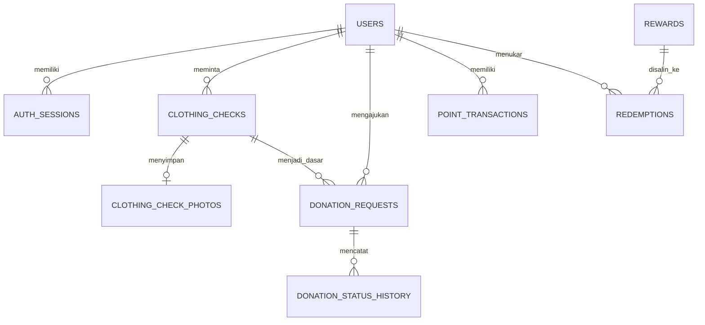

# Model data dan transaksi

Schema berjalan didefinisikan oleh [migrasi PostgreSQL 001–007](../backend/go/migrations/README.md). [PGStore](../backend/go/internal/store/README.md) memakai ID akun dari sesi. Waktu audit API memakai UTC, sementara jadwal penjemputan ditampilkan dalam `Asia/Jakarta`.

## Akun dan identitas

| Tabel | Isi dan batasan |
| --- | --- |
| `users` | `user_id` UUID, nama, email ternormalisasi unik, hash password, role `USER` atau `ADMIN`, saldo nonnegatif, username unik opsional, dan `email_verified_at`. |
| `auth_sessions` | `session_id`, pemilik, digest access/refresh unik, waktu kedaluwarsa, dan waktu pembuatan. Rotasi mengganti kedua digest. Logout menghapus satu sesi. |
| `email_registrations` | Challenge unik per email dengan hash password, digest OTP, batas kirim ulang, waktu kedaluwarsa dan jumlah percobaan. Akun baru masuk `users` setelah verifikasi kode benar. |

Role user dan saldo awal disediakan oleh schema saat pendaftaran. `create-admin` menetapkan role admin secara eksplisit. Perubahan password menghapus sesi lain dalam transaksi yang sama. [Migrasi akun](../backend/go/migrations/001_accounts_and_sessions.sql) · [Profil](../backend/go/migrations/006_account_profiles.sql) · [OTP](../backend/go/migrations/007_email_registration.sql)

## Pemeriksaan, pickup dan riwayat

| Tabel | Isi dan batasan |
| --- | --- |
| `clothing_checks` | Pemeriksaan dengan pemilik, kategori pakaian, hasil dan deskripsi AI, rekomendasi opsional, dan referensi foto. |
| `clothing_check_photos` | JPEG privat ternormalisasi hingga 2 MiB, dikaitkan dengan `check_id`. |
| `clothing_check_requests` | Key unik menurut akun, hash payload, klaim dan batas waktunya, serta referensi hasil ketika berhasil. |
| `donation_requests` | Donatur, pemeriksaan miliknya, kontak, alamat, kota, kuantitas, preferensi tanggal/jam, jadwal final, alasan penolakan, status, waktu, dan versi. |
| `donation_status_history` | Key `(donation_id, version)`, status sebelumnya dan baru, pelaku, serta waktu perubahan. `previous_status` kosong untuk versi pertama. |
| `donation_submit_requests` | Key unik menurut donatur, hash request, dan ID pengajuan hasil sehingga retry dapat diulang dengan aman. |

Foreign key gabungan `(check_id, user_id)` mengikat pengajuan ke pemeriksaan donatur yang sama. Daftar memakai urutan stabil `(created_at, donation_id)` dan cursor. Pencarian terbaru memakai urutan terbalik. Preferensi donatur tetap tersimpan ketika admin menetapkan jadwal final. [Schema pickup](../backend/go/migrations/002_pickup_and_donations.sql) · [Schema foto](../backend/go/migrations/003_vision_and_private_photos.sql) · [Schema idempotensi pickup](../backend/go/migrations/005_donation_submit_idempotency.sql)

## Poin dan penukaran

| Tabel | Isi dan batasan |
| --- | --- |
| `rewards` | Katalog aktif dengan ID, judul, deskripsi, ikon, tipe, dan biaya poin positif. |
| `redemptions` | Reward dan pemilik, snapshot nama/deskripsi/ikon/tipe, jumlah poin yang dipakai, saldo tersisa saat transaksi, waktu, dan key idempoten unik per akun. |
| `point_transactions` | Ledger dengan `points` bertanda. Kredit memakai satu `donation_id` unik dan bernilai +10. Debit memakai satu `redemption_id` unik dan bernilai negatif. |

Katalog menyediakan badge 10 poin, wallpaper 20 poin, dan voucher demo 30 poin. Snapshot menjaga isi riwayat ketika katalog berubah. Saldo yang dibaca aplikasi berada di `users.total_points` dan diperbarui bersama ledger. [Schema poin dan reward](../backend/go/migrations/004_rewards_and_ledger.sql)

## Batas transaksi

| Operasi | Langkah atomik | Cara mengulang |
| --- | --- | --- |
| Verifikasi OTP | Validasi challenge, buat akun dan sesi, konsumsi challenge. | Kode yang telah dipakai ditolak. |
| Pemeriksaan foto | Selesaikan klaim dengan menulis hasil pemeriksaan dan JPEG, lalu kaitkan hasil ke key. Groq dipanggil sebelum commit hasil. | Pakai key dan payload yang sama. Payload lain dengan key lama ditolak. |
| Submit pickup | Periksa hasil layak milik donatur, masukkan pengajuan versi 1, tulis riwayat awal, rekam key. | Gunakan key yang sama ketika hasil request sebelumnya belum pasti. |
| Jadwal, tolak, atau maju status | Kunci pengajuan, cek versi dan transisi, perbarui baris, tambahkan riwayat. | Jika versi berubah, muat detail terbaru sebelum memberi keputusan lagi. |
| Selesaikan donasi | Simpan perubahan dari `PICKED_UP` menjadi `COMPLETED`, riwayat, kredit unik +10 dan saldo. | Versi atau status lama menghasilkan konflik. Kredit unik mencegah saldo bertambah dua kali. |
| Redeem | Kunci saldo pemilik, cek key dan reward aktif, simpan snapshot, tulis debit, kurangi saldo. | Key dan reward yang sama mengembalikan snapshot awal. Muat kembali saldo terkini untuk UI. |

Setiap operasi menulis bagian yang saling terkait dalam satu transaksi sehingga kegagalan membatalkan keduanya. Contoh tes konkurensi dan rollback ada di [suite store](../backend/go/internal/store/store_integration_test.go). [Alur admin](donation-review-go.md) · [Alur redeem](completion-rewards.md)

## Penyimpanan Android

Room versi 2 berisi draf fondasi dan draf jadwal admin. Draf jadwal dipisah berdasarkan `adminId` dan `donationId`. Tema disimpan di DataStore. Data transaksi donasi, foto privat, ledger, dan redeem tetap dibaca dari API. [Room](../android/app/src/main/java/id/ac/loopy/data/local/README.md) · [Schema Room](../android/app/schemas/README.md)
